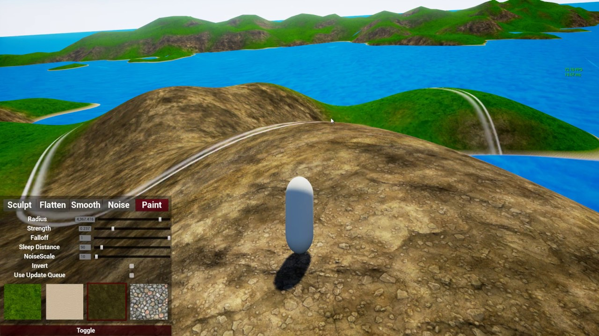

# TerrainEditor UE4
## Aviso de actualización 2020/2021: 
Este proyecto se detuvo de manera abrupta a finales de 2016 cuando perdí mucho progreso sin confirmar (uncommitted) debido a múltiples fallos de disco duro. Desde entonces, pude restaurar parte de la funcionalidad. La principal diferencia con lo que hay actualmente en GitHub es que las "secciones de terreno" (ver terrainSection.cpp) fueron reemplazadas por un enfoque basado en clipmap (ver: https://developer.nvidia.com/gpugems/gpugems2/part-i-geometric-complexity/chapter-2-terrain-rendering-using-gpu-based-geometry) que permite renderizar un terreno casi infinito. Tenía planeado volver a publicar este proyecto de demostración como un plugin reutilizable, pero simplemente no me he tomado la molestia de corregir algunos defectos arquitectónicos del proyecto aún. \

Además, para quienes me preguntan por los términos de la licencia, siéntanse libres de usarlo como deseen. Esta demostración les dará una buena idea de cómo implementar un terreno que se pueda editar en tiempo de ejecución, pero tengan en cuenta que **no** fue creado por un profesional (y para ahora mismo, probablemente ya sea posible editar el componente de paisaje real en tiempo de ejecución sin modificar el código fuente de UE4).

### Acerca del proyecto
- Un conjunto de componentes que hace posible la manipulación del terreno desde dentro del juego.
- No utiliza el componente de paisaje propio de Unreal Engine. En su lugar, genera una malla procedural que actúa como el terreno. 
- Desarrollado con C++. 
- API expuesta a través de Blueprint. Simplemente agregue el "SculptComponent" a su personaje jugador y conecte la API mínima.
- Funciona con el ProceduralMeshComponent y el RuntimeMeshComponent.

### Ejemplo
Haga clic en la imagen para verlo en acción en YouTube:

[Hilo en el foro](https://forums.unrealengine.com/community/work-in-progress/96841-ingame-terraineditor-with-source)

### Para comenzar:
- Asegúrese de tener instalado el RuntimeMeshComponent
- Clone o descargue este proyecto
- Haga clic derecho en el archivo uproject, seleccione "Generate Visual Studio project files"
- Abra el archivo sln generado y compílelo.
- Inicie Unreal Engine 

### Créditos:
- Chris Conway (Koderz) - por el [RuntimeMeshComponent](https://github.com/Koderz/UE4RuntimeMeshComponent)
- Afan Olovcic (DevDad) - por el [SimplexNoise Plugin](https://github.com/devdad/SimplexNoise)
